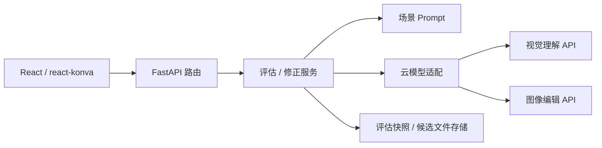

# Conveditor 项目架构

## 目标与当前范围

题 B：动画 AI 编辑器。前端使用 React、TypeScript 和 react-konva，后端使用 FastAPI，通过云端 API 调用视觉理解与图像编辑模型。重点是人机协作绘画工作流：画稿编辑、评估建议、用户选择、生成修正候选、对比和采纳。

当前已实现单幅动画画稿的协作编辑 MVP：画笔、橡皮、图片导入导出、局部选区、阶段目标、真实模型评估、建议选择、修正候选对比及采纳、版本保存、恢复和删除。前端工作区保存到 IndexedDB；后端保存评估快照、候选 PNG 和生成指令到本地 `data/`。没有密钥时仍可手绘，但模型操作不可用，不提供运行时 MOCK 回退。交互决策、阶段 Prompt 和验收场景见 [docs/workflow.md](./docs/workflow.md)。

## 目录与模块

| 目录 | 模块职责 |
| --- | --- |
| `frontend/` | 前端应用、构建配置和依赖；负责交互与呈现。 |
| `frontend/src/app/` | 页面入口、应用布局和全局样式；组合各功能模块。 |
| `frontend/src/features/editor/` | react-konva 画布、画稿编辑、修改范围选择及随选区定位的多轮对话浮窗。 |
| `frontend/src/features/evaluation/` | 创作目标与绘画阶段输入、评估建议展示和建议选择。 |
| `frontend/src/features/editing/` | 提交所选修正建议、候选图预览、前后对比及采纳或放弃。 |
| `frontend/src/features/history/` | 用户画稿版本和已采纳修改的浏览、恢复和删除。 |
| `frontend/src/api/` | 前端访问应用后端的请求封装与错误映射。 |
| `frontend/src/types/` | 前端共享的画稿、建议、候选图等类型；与后端 `schemas/workflow.py` 契约保持对齐。 |
| `backend/` | Python 应用、构建配置和依赖；负责模型调用与应用业务边界。 |
| `backend/src/conveditor/` | 后端 Python 包；`main.py` 装配 FastAPI 应用。 |
| `backend/src/conveditor/api/` | HTTP 接口模块；将请求交给服务模块。 |
| `backend/src/conveditor/api/routes/` | 健康检查、画稿评估、候选生成、选区会话和 PNG 产物读取。 |
| `backend/src/conveditor/schemas/` | 请求、响应和模型结果的数据契约及结构校验。 |
| `backend/src/conveditor/services/` | 评估与修正用例编排，连接 Prompt、模型适配和存储。 |
| `backend/src/conveditor/providers/` | 云端模型 SDK/HTTP 适配；封装视觉理解、图像编辑接口及供应商响应差异。 |
| `backend/src/conveditor/prompts/` | 按绘画阶段与修正场景维护的评估、编辑 Prompt。 |
| `backend/src/conveditor/storage/` | 本地评估快照和候选产物存储；用户可恢复版本由前端 IndexedDB 管理。 |

## 调用与依赖边界

下图描述当前模型调用链；浏览器另行保存用户工作区及可恢复版本。

- 前端只访问应用后端；模型密钥和供应商接口适配保留在后端。
- API 路由处理 HTTP 输入输出，服务模块组织用例，模型适配模块处理供应商协议。存储模块管理产物，Prompt 模块管理场景指令。
- 评估和修正是两次独立业务调用：评估返回建议，用户选择后才请求修正。修正先产生候选，用户采纳后再更新画稿。
- 选区对话是另一条入口：框选后可直接多轮提问，点击“修改选区”才允许生成。会话保存源图、Brief 及最近 10 轮消息。LLM 同时查看整图和选区裁图；图像模型接收完整原图与同尺寸 PNG 遮罩，选区完全透明、框外不透明。模型生成完整候选后，应用按同一选区保留框外原始像素和透明度，采纳前需检查框内非目标部位与边缘衔接。改变画稿、目标或选区后开启新会话，候选仍需明确采纳。
- 画稿版本与模型调用状态含义不同：历史模块面向用户编辑过程，调用状态面向请求执行过程。
- 修改范围与保留要求保存在评估快照中。图像模型接收完整原图和编辑指令；有选区时同时上传原生遮罩，选区对话与评估建议修正均在完整生成结果上保护框外原始像素。遮罩是模型编辑引导，严格的框外保护由应用负责；生成请求指定不透明背景，Prompt 约束原色和未要求修改的光影。
- 模型调用使用异步 HTTP 请求，前端在请求期间锁定画稿和目标；没有任务队列、Worker、自动重试或断点续跑。画稿或目标改变后清除旧评估。候选仅在用户采纳时更新前端画稿。
- 密钥从根目录 `.env` 或环境变量读取，仅后端使用。图片编辑默认使用 `gpt-image-2`，可通过 `IMAGE_EDIT_API_KEY` 和 `IMAGE_EDIT_BASE_URL` 独立配置服务，未填写的项沿用对应的 `OPENAI_*` 配置。供应商适配需要支持 Responses 图片输入、结构化输出和带 `image` / `mask` 文件的 Images Edit multipart 接口；修改 base URL 不代表兼容任意厂商。
- 当前是本机单用户应用，没有鉴权和项目隔离；共享部署前需另行设计。测试中的模型响应桩仅用于自动化验证，不能作为真实模型效果证明。

## 开发入口

安装、启动、配置和测试命令见 [README.md](./README.md)。前端开发服务器将 `/api` 转发到本机 FastAPI；存在前端构建产物时 FastAPI 同时提供静态页面。新增模块按上表放置，并同步维护目录说明及当前实现范围。
