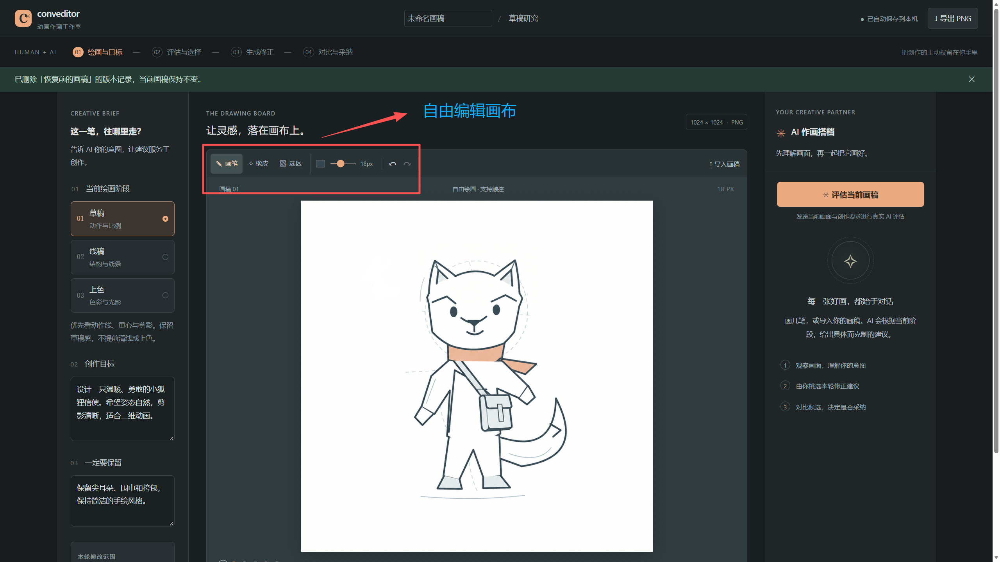
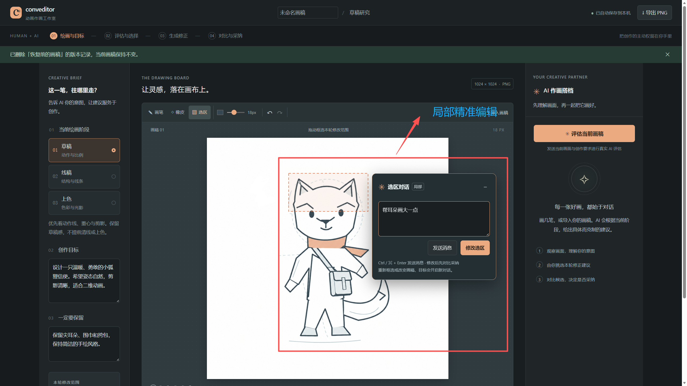
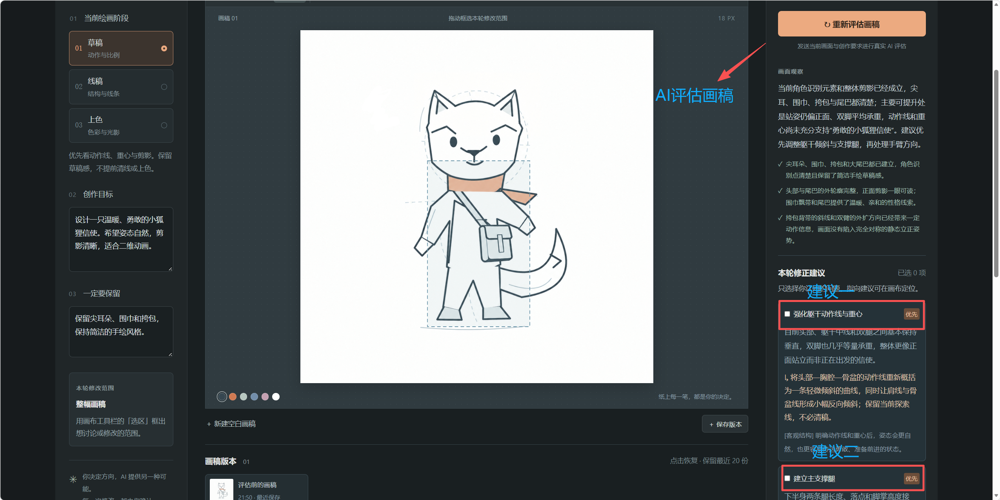
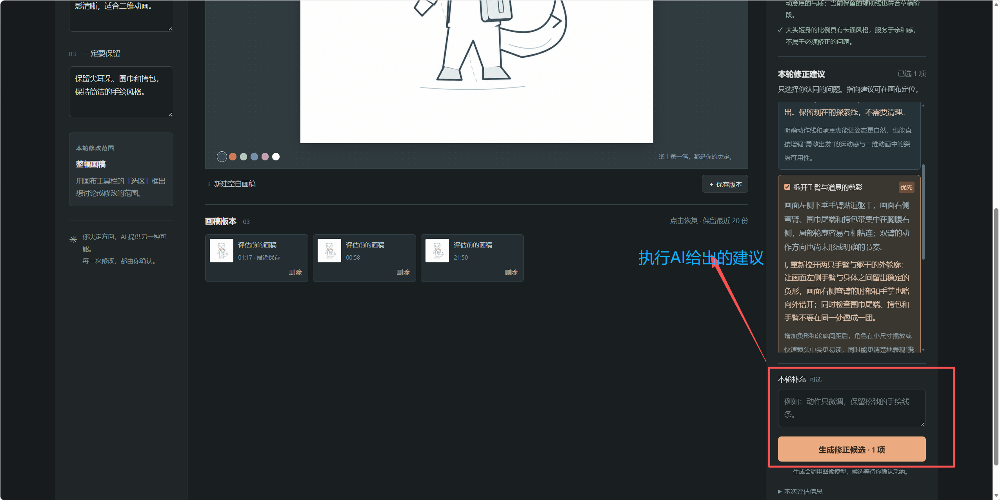
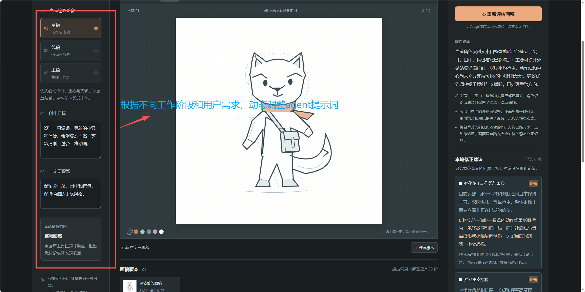
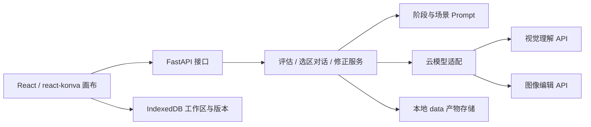

# Conveditor · 动画 AI 作画工作室

Conveditor 是一个面向二维动画角色作画的 AI 协作编辑器，也是“题 B：动画 AI 编辑器”的可运行实现。你可以从手绘或导入画稿开始，让 AI 结合当前绘画阶段和创作意图分析画面，再由自己选择修正建议、对比生成结果，决定是否采纳。

**绘画与目标 → 评估与选择 → 生成修正 → 对比与采纳 → 继续绘画**

> 你决定方向，AI 提供另一种可能。每一次修改，都由你确认。

[功能展示](#功能展示) · [协作流程](#协作流程) · [技术架构](#技术架构) · [快速开始](#快速开始) · [VS Code 调试](#vs-code-调试) · [测试与验证](#测试与验证)

## 功能展示

以下五张截图展示了项目的实际界面与主要交互，以内置的“狐狸信使”原创草稿为例。

### 1. 自由绘画：让灵感落在画布上

工作区采用三栏布局：左侧填写绘画阶段与创作要求，中间编辑画稿，右侧查看 AI 反馈。画师可以一边观察角色，一边调整目标和修改范围。



*图 1：画布工具栏提供画笔、橡皮、选区、颜色、笔宽和撤销/重做，支持直接在画稿上继续创作。*

- **基础绘画工具**：1024 × 1024 画布，支持画笔、橡皮、颜色与笔宽设置、撤销和重做，以及触控绘画。
- **画稿导入导出**：支持 PNG / JPEG / WebP 导入与 PNG 导出；非正方形图片等比置于白色画布中。也可直接载入内置的狐狸信使示例。
- **命名与自动保存**：点击顶部名称即可重命名，按 Enter 或点击别处确认；画稿与名称自动保存到浏览器，刷新后可恢复。

### 2. 选区对话：用自然语言讨论和修改局部

切换到“选区”工具，在画布上拖出矩形，即可在选区旁打开对话浮窗。例如，框住耳朵后输入“帮耳朵画大一点”，就能围绕这个局部与 AI 沟通。



*图 2：选区旁的浮窗提供“发送消息”和“修改选区”两个入口，可先讨论，再明确发起修改。*

- **发送消息**：模型结合整幅画面、选区裁图和最近 10 轮上下文回复；聊天本身不会触发图像生成。
- **修改选区**：将明确的文字要求整理成编辑指令，生成一个待确认的候选；要求不清楚时先提问，无需先做整图评估。
- **范围保护**：图像模型接收完整原图和同尺寸 PNG 遮罩；应用在生成后恢复框外原始像素及透明度。采纳前仍需检查框内非目标部位和边缘衔接。

浮窗支持收起/展开，会随滚动和窗口尺寸调整位置；`Ctrl / ⌘ + Enter` 可发送消息。悬停或聚焦“选区”按钮可查看操作说明。重新框选、修改画稿或创作要求会开启新对话，修改画稿名称不影响会话；刷新可恢复画稿和选区，但不恢复聊天历史。

### 3. AI 评估：从画面证据到可执行建议

点击“评估当前画稿”，模型会读取实际画面、阶段与创作资料，先总结画面和已有优点，再提出至多 5 条修正建议。截图中，AI 围绕狐狸信使的动作目标，给出了“强化躯干动作线与重心”“建立主支撑腿”等建议。



*图 3：每条建议包含画面证据、具体修正动作、理由与优先级；指向建议时可在画布上定位问题。*

建议默认不勾选。你可以只选择认同的问题，补充“动作只微调，保留松弛的手绘线条”等要求，再点击“生成修正候选”。生成指令只包含已选建议；修改画稿、阶段、目标或选区后，旧评估会失效，需要重新评估。



*图 4：勾选要执行的建议后，可填写补充要求，再点击“生成修正候选”；生成结果仍需对比并确认采纳。*

### 4. 阶段与目标：让 AI 理解当前创作意图

同一幅角色画稿，在草稿、线稿和上色阶段需要不同的反馈。左侧的“当前绘画阶段”“创作目标”“一定要保留”共同定义本轮创作要求，后端据此组合评估与编辑 Prompt，并加入修改范围约束。



*图 5：通过阶段与用户需求调整提示词，让建议服务于当前创作任务。*

| 当前阶段 | AI 关注重点 | 编辑约束 |
| --- | --- | --- |
| 草稿 · 动作与比例 | 动作线、重心、剪影、透视与大比例 | 保留探索线和草稿感，不提前清线或上色。 |
| 线稿 · 结构与线条 | 轮廓连续性、遮挡关系、关节连接、线条主次 | 保留已确定的动作、构图与角色特征。 |
| 上色 · 色彩与光影 | 固有色分区、明度分离、光源与阴影一致性 | 保留原有线稿和角色识别色，避免无关的写实渲染。 |

例如，将目标设为“让小狐狸信使的奔跑更有向前冲的动势”，同时要求“保留尖耳朵、围巾和挎包，保持简洁的手绘风格”，这些信息会同时约束评估和生成。阶段 Prompt 的实现位于 [workflow.py](backend/src/conveditor/prompts/workflow.py)，选区对话 Prompt 位于 [region.py](backend/src/conveditor/prompts/region.py)。

### 5. 对比与版本：由你决定是否留下这次修改

- **先对比再采纳**：候选在独立弹窗中展示，支持滑动对比和并排对比，可展开查看实际生成指令。采纳后更新画布并保存新版本，放弃则保留原图。
- **继续手绘**：采纳结果仍可作为当前画稿继续编辑，再次进入评估与修正流程。
- **保留创作节点**：支持手动保存版本；评估前、导入前、清空前及采纳时也会保存，最近 20 个版本可浏览、恢复和逐个删除。
- **恢复前留档**：尚未留档的画稿及创作要求会在恢复历史版本前自动保存；重复点击当前版本或在已保存版本间切换不会新增副本。删除版本不影响当前画稿。

## 协作流程

项目提供“评估后选择建议”和“直接讨论选区”两条入口，生成结果都需要用户明确采纳。

1. **准备画稿**：载入狐狸信使示例或导入自己的图片，也可以直接从空白画布开始绘画。内置示例是原创矢量草稿。
2. **说明意图**：选择草稿、线稿或上色阶段，填写创作目标与保留要求；需要局部修正时拖出矩形选区。
3. **获取反馈**：点击“评估当前画稿”查看画面分析与建议；也可以在选区浮窗直接提问或提交具体修改要求。
4. **发起生成**：在评估面板勾选认可的建议后生成候选，或在选区浮窗点击“修改选区”。
5. **对比决定**：检查角色特征、画风、修改范围及边缘衔接，选择采纳或放弃。
6. **继续创作**：采纳后继续手绘、保存版本或导出 PNG；需要回退时点击历史版本恢复。

更详细的交互决策、Prompt 场景设计与验收用例见 [工作流文档](docs/workflow.md)。

## 技术架构

前端使用 React、TypeScript 和 react-konva，后端使用 FastAPI。视觉理解负责评估与选区对话，图像编辑负责生成候选；两类能力通过后端调用真实云端接口，模型密钥只保存在后端。



| 目录 | 职责 |
| --- | --- |
| [frontend/src/app](frontend/src/app/) | 页面入口、布局、全局样式与工作流组合。 |
| [frontend/src/features](frontend/src/features/) | 画布与选区对话、评估建议、候选对比和历史版本。 |
| [frontend/src/api](frontend/src/api/) / [types](frontend/src/types/) | 后端请求封装及共享数据类型。 |
| [backend/src/conveditor/api](backend/src/conveditor/api/) / [services](backend/src/conveditor/services/) | HTTP 接口与用例编排。 |
| [backend/src/conveditor/providers](backend/src/conveditor/providers/) / [prompts](backend/src/conveditor/prompts/) | 模型协议适配与阶段、场景指令。 |
| [backend/src/conveditor/schemas](backend/src/conveditor/schemas/) / [storage](backend/src/conveditor/storage/) | 数据契约校验与评估、会话、候选产物存储。 |

完整模块边界见 [AGENTS.md](AGENTS.md)。当前实现聚焦单幅动画画稿的协作编辑，没有多帧时间轴或专业图层系统。

## 快速开始

### 环境与模型配置

需要 Node.js 22.12+（或 20.19+）、Python 3.11+ 和 uv。

在项目根目录复制配置：

```powershell
Set-Location D:\conveditor
Copy-Item .env.example .env
```

在 `.env` 中填写自己的密钥，已有 `.env` 时直接编辑，勿覆盖：

```dotenv
OPENAI_API_KEY=你的服务端密钥
OPENAI_BASE_URL=https://api.openai.com/v1
EVALUATION_MODEL=gpt-4.1-mini
IMAGE_EDIT_MODEL=gpt-image-2
MODEL_TIMEOUT_SECONDS=180
```

评估与图片编辑默认共用 `OPENAI_API_KEY` 和 `OPENAI_BASE_URL`。需要为图片编辑使用另一家服务时，在 `.env` 中设置 `IMAGE_EDIT_API_KEY` 和 `IMAGE_EDIT_BASE_URL`；未填写的项继续使用对应的 `OPENAI_*` 配置，评估服务不受影响。

默认评估调用 Responses API 的图片输入和严格结构化输出；修正使用 `gpt-image-2` 的 Images Edit API，以 multipart 上传完整画稿，有选区时同时上传同尺寸 PNG 遮罩，并读取完整候选的 base64 PNG。接口实现参考 [OpenAI 结构化输出文档](https://developers.openai.com/api/docs/guides/structured-outputs)、[图片输入文档](https://developers.openai.com/api/docs/guides/images-vision) 与 [图像编辑文档](https://developers.openai.com/api/reference/python/resources/images/methods/edit)。模型名称可以配置；使用兼容服务时，图片编辑服务需支持 `image` 与 `mask` 文件，各服务需支持对应的调用协议，仅支持 Chat Completions 的服务不能直接用于评估。

密钥需要对应模型的访问权限和可用额度。未配置时可以使用画布，AI 操作不可用。更改配置后重启后端并刷新页面。`/api/health` 的 `configured` 仅代表密钥已填写，不代表额度、模型权限或网络已验证。

### 启动

开发模式，在两个终端分别运行：

```powershell
Set-Location D:\conveditor\backend
uv sync --locked
uv run uvicorn conveditor.main:app --host 127.0.0.1 --port 8000
```

```powershell
Set-Location D:\conveditor\frontend
npm ci
npm run dev
```

打开 <http://localhost:5173>。Vite 会将 `/api` 转发到 `127.0.0.1:8000`。API 文档：<http://127.0.0.1:8000/docs>。

也可以只运行一个后端服务：先在 `frontend/` 执行 `npm run build`，再启动上述后端。FastAPI 会提供 `frontend/dist` 静态页面，打开 <http://127.0.0.1:8000> 即可。端口占用时可改为 `--port 8001` 并直接打开该端口；开发模式下则需同步修改 Vite 代理。

## VS Code 调试

用 VS Code 打开项目根目录 `D:\conveditor`，安装 `.vscode/extensions.json` 推荐的 **Python** 和 **Python Debugger** 扩展。先按“启动”一节执行 `uv sync --locked` 和 `npm ci` 安装依赖；调试配置会启动服务，无需提前运行启动命令。

按 `Ctrl+Shift+D` 打开“运行和调试”，选择配置后按 `F5`：

| 配置 | 行为 |
| --- | --- |
| 全栈：FastAPI + Vite + Edge | 先启动后端，后端就绪后启动 Vite，前端就绪后自动打开带调试器的 Edge。 |
| 后端：FastAPI | 只调试后端，可打开 `http://127.0.0.1:9002/docs` 发送请求。 |
| 前端：Vite + Edge | 启动 Vite 和 Edge，调试 React / TypeScript；调用 API 时需要后端已在 9002 端口启动。 |

在 `backend/src/conveditor/` 的 Python 文件或 `frontend/src/` 的 TypeScript / TSX 文件行号旁点击设置断点，然后在页面触发对应操作。可先在 `backend/src/conveditor/api/routes/health.py` 的 `settings = get_settings()` 行设置断点，刷新页面验证后端断点；前端可在 `frontend/src/app/App.tsx` 的操作处理函数中设置断点。

调试使用后端 9002、前端 5175，页面地址为 `http://localhost:5175`。前端调试通过 `--port` 指定端口，通过 `CONVEDITOR_API_PROXY` 设置 API 代理；普通终端启动仍默认使用后端 8000、前端 5173。以后修改调试端口时，需同步更新 `.vscode/launch.json` 中两个后端配置的 `args`、后端就绪匹配、前端 `args`、API 代理和前端就绪匹配。

后端调试固定使用 `backend/.venv/Scripts/python.exe`，读取根目录 `.env`，不开启 Uvicorn 自动重载；修改 Python 后重启后端调试会话，前端仍支持 Vite 热更新。若编辑器选择了其他 Python 环境，执行 `Python: Select Interpreter` 并选择该虚拟环境。启动前确保 9002、5175 端口没有其他服务或 SSH 转发占用。

全栈调试结束时，在调试工具栏选择 **全栈：FastAPI + Vite + Edge** 会话再停止；停止后端会连带停止 Vite 和浏览器调试会话。单独关闭浏览器调试会话不会停止服务。若使用 Chrome，将 `.vscode/launch.json` 中前端的 `serverReadyAction.action` 改为 `debugWithChrome`。配置字段参考 [VS Code 调试配置文档](https://code.visualstudio.com/docs/debugtest/debugging-configuration)。

## 测试与验证

```powershell
Set-Location D:\conveditor\backend
uv run pytest -q

Set-Location D:\conveditor\frontend
npm run build
npx playwright install chromium
npm test
```

后端测试覆盖 API 校验、已选建议约束、源图保护、遮罩坐标与透明度、框外原色及透明度保护、失败重试、三个阶段的 Prompt，以及通过本地 HTTP 服务器验证真实 OpenAI SDK 的原图与遮罩 multipart 请求/响应协议。浏览器测试覆盖绘画、撤销、框选、持久化、旧评估失效、候选采纳/放弃和移动布局。

**自动化测试不消耗模型额度，也不证明真实生成质量。** 生产代码无 MOCK 分支；真实云端验收必须配置有效密钥，按上面的演示流程跑完一次评估和生成，人工检查模型输出。

## 数据与当前边界

- 浏览器 IndexedDB 保存当前画稿和版本；清理网站数据会丢失这些记录。不同域名/端口是不同工作区。导出 PNG 可独立备份。
- 后端 `data/` 保存评估原图、评估结果、选区会话、候选图片和生成指令。目录和 `.env` 均已加入忽略规则。可通过 `DATA_DIR` 指定绝对存储路径；目前不自动清理产物。
- 局部修正使用完整原图、原生 PNG 遮罩与指令，生成后由应用保证框外原始像素和透明度不变。遮罩仍是模型的范围引导，选区内非目标内容与边界衔接需人工检查。
- 配置、鉴权、额度、超时、上游拒绝和格式错误都有对应的失败提示；不自动重试计费调用。
- 每次生成一个候选、medium 质量，输出请求为 1024 方图与不透明背景；未指定的颜色、明度和光影受 Prompt 保留约束。请求期间锁定画稿，不展示虚构百分比；请求超时或服务重启不能断点续跑，手动重试可能重复计费。刷新保留画稿，不恢复正在执行的请求或尚未采纳的对比弹窗。
- 本机单用户 MVP，无登录、项目隔离、任务队列、多帧时间轴和多人协作。这里的“动画编辑”聚焦动画角色单幅作画流程。共享部署需要增加认证、配额和产物访问隔离。
