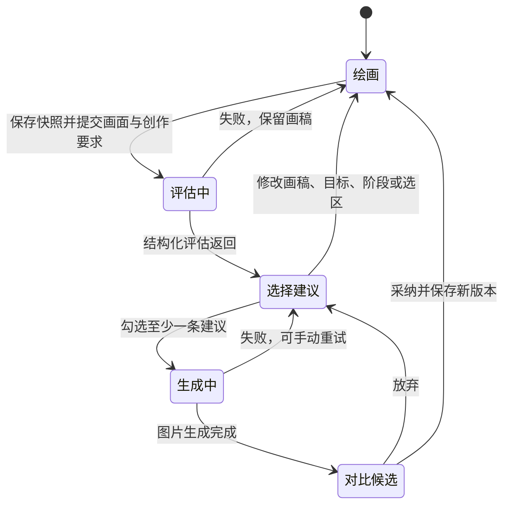

# 题 B：由作画工作流驱动的 AI 编辑

## 场景与决策

面向二维动画角色的单幅草稿、线稿和上色稿。画师负责创作目标、可变范围和采纳决策；多模态模型做可定位的审稿，图像模型根据画师选择生成修正候选。基础画布足够验证协作闭环，暂不实现时间轴、专业图层系统或性能优化。

核心产品决策是把“看出问题”和“替人改画”拆开：评估不修改画稿，建议默认不勾选，用户选择之后才能调用图像模型。候选展示在独立对比弹窗中，只有采纳才替换当前画稿。

## 状态与版本

请求期间锁定画布、目标和历史恢复，避免“模型评估了旧画稿却修改了新画稿”。后端用评估 ID 关联不可变的画面与 Brief；编辑接口只收评估 ID、建议 ID 和补充，不接受客户端替换评估原图或任意建议。前端画稿/目标变化会清除评估。候选与原画稿是不同产物。

画稿版本是用户创作节点，调用状态是当前请求状态。画笔每笔支持撤销；评估前、导入前、清空前以及采纳时保存版本，用户也可手动保存。恢复前仅在当前画稿或创作要求尚未留档时保存版本；重复点击当前版本或在已保存版本间切换不会新增副本。每张版本卡片提供删除按钮，只移除该历史记录，不影响当前画稿；请求期间禁用恢复和删除。最近 20 份版本和当前画稿保存在 IndexedDB，删除也会自动保存。候选未采纳前不进入用户版本。

顶部画稿名称可以直接编辑，按 Enter 或点击别处确认，空名称恢复为“未命名画稿”。名称作为工作区元数据保存到 IndexedDB，旧存档缺少名称时使用默认值。修改名称不新增画稿版本，也不使现有评估失效。

## 阶段场景与 Prompt 特调

Prompt 的单一实现位于 `backend/src/conveditor/prompts/workflow.py`，版本为 `animation-workflow-v3`。以下是按工作流设计的约束；尚未通过真实模型 A/B 实验量化收益。

| 作画阶段 | 典型问题 | 评估重点 | 生成约束 | 人工验收 |
| --- | --- | --- | --- | --- |
| 草稿 / 动作设计 | 跑步姿态僵硬、重心不稳、剪影重叠 | 动作线、重心、透视、大比例 | 保留探索线和未完成感；夸张比例可视为风格；不提前清线或上色 | 动作更可读，仍然是原来的角色和草稿 |
| 线稿 / 结构清理 | 肩部断开、手臂遮挡不清、轮廓线主次混乱 | 连续轮廓、遮挡、关节、特征一致 | 保持已确定的动作和构图，仅修改选中的线条问题 | 未选部位和角色识别点稳定，仍是线稿 |
| 上色 / 赛璐璐光影 | 角色与背景混在一起、阴影方向冲突 | 固有色分区、明度分离、统一光源 | 保留原线稿和角色识别色，避免写实材质与复杂渐变 | 光源一致、明度清楚，角色风格不漂移 |

评估 Prompt 要求：先反馈优点；至多 5 条不重复建议；每条必须给出可见证据、可执行动作和理由；无法定位时 region 为 null；无法判断时说明不确定；空白或无需修正时允许零建议。模型不能为了填充列表而杜撰问题，不能把风格偏好伪装成结构错误。

模型输入包含实际 PNG 和 JSON 创作资料，输出使用 Pydantic 定义的严格结构化数据。保留要求和修改范围进入评估与生成两步。生成指令只嵌入勾选的建议，不传入未选问题；补充只能细化这些建议，不能越过阶段和保留约束。

## 局部修正

选区对话提供独立于整图评估的入口。框选完成后，文本浮窗优先定位在矩形右侧，空间不足则移至左侧、下方或上方，并限制在视口内；可收起以便继续观察画面。普通消息只调用 LLM 回复，明确点击“修改选区”才允许生成。模型不能通过自己的意图判断绕过这个开关。

第一次发消息时保存不可变的画稿和 Brief，会话 ID 绑定这份快照。后续每轮向 LLM 提供整图、选区裁图、最近 10 轮上下文和新消息。修改模式下 LLM 将对话整理成自足的局部指令；要求不明确或超出选区时，返回澄清问题而不生成。图像编辑模型接收完整原图、同尺寸 PNG 遮罩和包含阶段及保留要求的局部指令。遮罩中选区完全透明（Alpha 为 0），其余区域不透明（Alpha 为 255），坐标与原图一一对应。生成请求指定不透明背景，指令要求未指定的原色和明度保持不变，不额外增加光影。模型返回完整画稿后，应用进行格式校验、常规图片归一化，并用同一选区保留框外源图的原始像素及透明度，再保存为候选。

会话在改变画稿、阶段、目标、保留要求或选区后失效，避免旧局部讨论应用到新图。请求失败保留输入内容，可以手动重试；成功的历史消息保存在后端会话中。采纳候选开启新对话，放弃候选可在原会话继续讨论。刷新不恢复前端会话 ID。Prompt 实现位于 `prompts/region.py`，版本为 `region-conversation-v3`。

矩形坐标统一为左上原点的 0–1 归一化坐标，与屏幕显示尺寸无关。框选图层只用于界面提示，不会出现在提交图片中。评估问题位置用另一种颜色显示，不自动更改用户的修正范围。

评估建议修正与选区对话修正共用原生遮罩方式：有选区时上传完整原图与遮罩，无选区时只上传完整原图。有选区的两条路径均在生成后保护框外像素，因此框外颜色、笔触和透明度严格保持原样；模型仍能看到完整上下文。选区内的非目标部位和边缘衔接由用户在对比阶段确认。若要改变动作的大轮廓，应扩大选区或使用全图修正。

## 接口和产物

| 接口 | 输入/行为 | 输出 |
| --- | --- | --- |
| `GET /api/health` | 本地服务与配置检查，不触发模型调用 | configured、模型名称；不返回密钥 |
| `POST /api/evaluations` | base64 图片、阶段、目标、保留要求、选区 | 评估 ID、总结、优点、建议、模型和 Prompt 版本 |
| `POST /api/edits` | 评估 ID、已选建议 ID、补充 | 候选 ID、图片地址、实际生成 Prompt、模型、范围处理方式 |
| `POST /api/region-sessions` | 画稿、Brief（必须包含有效选区），不调用模型 | 绑定画稿快照的会话 ID |
| `POST /api/region-sessions/{id}/messages` | 用户消息和明确的 chat / edit 模式 | LLM 回复，可选的局部修正候选 |
| `GET /api/artifacts/{id}.png` | 受格式校验的产物 ID | PNG 文件 |

源图与评估 JSON 在模型成功评估后保存到磁盘；编辑始终读取这份快照。候选另存为独立 PNG 和 JSON。采纳操作发生在前端，下载图片并写入可继续绘制的画稿，原始评估产物不被覆盖。

## 验收方案

自动化测试只验证协议和工作流。真实模型效果要用同一批画稿、明确目标与相同模型配置重复评审。

| 用例 | 操作 | 通过条件 |
| --- | --- | --- |
| 草稿阶段克制 | 上传动作草稿，仅选重心建议 | 未自动清线/上色；动作改善；保留角色识别点 |
| 线稿局部修正 | 框选手臂，要求连接轮廓 | 原图与遮罩同尺寸且坐标对应；手臂结构改善；框外原始像素及透明度完全一致；边界自然 |
| 上色光源修正 | 指定左上光，保留围巾颜色 | 阴影方向统一；围巾识别色和线稿不变 |
| 选择权 | 评估返回多条，仅勾选一条 | 编辑 Prompt 只包含这一条，其余不主动修正 |
| 不确定性 | 上传模糊草稿或只画一笔 | 不虚构细节；允许零建议和说明不确定 |
| 过期结果 | 评估后继续绘画或改目标 | 旧评估消失，必须重新评估后才能生成 |
| 候选隔离 | 生成后分别放弃与采纳 | 放弃原图不变，采纳生成新版本，能撤销或恢复 |
| 服务失败 | 无密钥、无额度、超时、拒绝响应 | 可理解的提示；画稿保留；请求解锁；没有自动重复计费调用 |

建议记录每张图的 Prompt 版本、实际模型、所选建议、是否采纳，以及“目标改善 / 角色保持 / 风格保持 / 范围遵守 / 边界衔接”各项的人工判断。当前没有成批样本的效果统计，不宣称已完成效果调优实验。

2026-10-15 使用旧裁图与回贴方案完成一次真实选区对话与改图验收：`gpt-6-luna` 正确描述示例狐狸围巾为浅杏粉色并建议蓝色；随后 `gpt-image-2` 按要求生成浅天蓝色围巾。目视检查确认改色结果，逐像素检查确认选区外无变化。这是旧方案的一次接口和工作流实测，不代表原生遮罩方案的效果，也不代表所有局部编辑均能达到相同质量。

同日使用仅接受完整模型输出的原生遮罩版本实测：将 1024 × 1024 狐狸原图与同尺寸 PNG 遮罩一起上传给当前配置的 `gpt-image-2`，要求缩小耳朵。接口接受请求并返回 1024 × 1024 完整候选，应用未做范围保护。目视检查中耳朵缩小后头部轮廓仍保持连接；逐像素比较发现框外像素也有变化。原图、遮罩、完整候选及报告保存在 `data/mask-edit-smoke-20261015/`。该历史版本验证接口可用，但暴露了仅依赖模型遮罩不能严格保护框外颜色的问题。

随后针对用户反馈的灰色明暗与背景透明度变化，增加框外像素保护、不透明背景请求和原色保留指令。重放该次真实失败候选后，框外变化为 0 像素；再次用同一狐狸原图和选区调用 `gpt-image-2`，返回图不透明，最终候选框外变化仍为 0 像素。目视检查中耳朵缩小，白色人物填充保持原样，额头采样区域平均色值偏移约 0.12。原图、遮罩、模型原始输出、受保护候选和报告保存在 `data/mask-color-protection-20261015/`。框内非目标细节和边缘衔接仍需逐次确认。

## 后续边界

当前异步 HTTP 足以支撑单用户分钟级请求。若扩展到多用户或更长任务，需要持久化请求状态、请求幂等键、后台 Worker、鉴权与产物隔离。模型超时后的费用和是否已执行不能由客户端推断，因此当前明确提示手动重试可能重复计费；不把请求失败当作自动再生成的理由。
